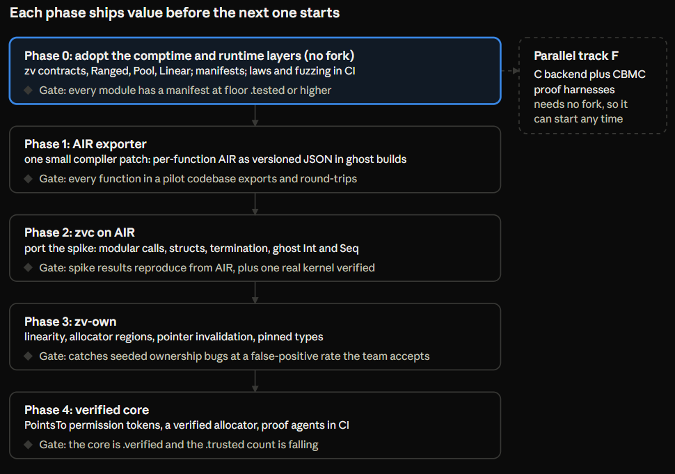

# Verified Zig: A Formalization Layer for Multi-Contributor Zig

Oct 28, 2026 · @Isaac

> Working name in early drafts was "Ziggurat"; the project is now **Zirakzigil**. The prototype has since been ported from Zig 0.16 to 0.17 (see the README); numbers below are from the original 0.16 runs.

## Summary

We can get much of what makes Rust safe for large teams into Zig without forking the language, by stacking four layers: comptime contracts and refinement types, runtime ownership backstops, a static ownership checker over Zig's AIR, and a Verus-style SMT verifier for a small core. A compile-time **assurance manifest** ties them together. The first three layers and a verifier spike were built and run on the stock Zig 0.16.0 compiler for this doc.

- **Thesis.** Rust's borrow checker helps teams because signatures carry machine-checked ownership facts, so mistakes are reported locally. The Zig goal is the same: move invariants out of authors' heads into checked signatures and contracts.
- **What we borrowed.** From Verus: three modes, contracts in host syntax, ghost erasure, and linear permission tokens so the solver never reasons about aliasing. From Bend 2: human-owned laws as a commit gate. From SPARK: a borrow checker can live in the verifier rather than the compiler.
- **What Zig uniquely gives us.** Comptime builds refinement types, brands and governance gates with no runtime cost; build options make ghost code free; explicit allocators make regions explicit; 0.16's `Io` parameter makes effects visible in signatures.
- **What Zig withholds.** No analyzer API, and AIR is reachable only from a custom compiler build. Silent struct copies defeat in-type ownership flags.
- **Prototype results.** 9/9 tests in every build mode; 10/10 negative cases (4 runtime panics, 6 compile errors); the verifier proved 4 functions, rejected the 2 planted bugs (including the classic `(lo + hi) / 2` overflow, counterexample `lo=1, hi=4294967295`) and caught 5/5 injected mutants, in 0.9 s.
- **Recommendation.** Adopt layers A to C and the manifest now. Build the AIR exporter and `zv-own` next as the main research bet. Reserve full verification for a small core.

## The problem: Zig's invariants live in the author's head

Rust's borrow checker is not mainly a safety feature for teams. It is a **modularity** feature: a function signature carries enough machine-checked information about ownership, aliasing and lifetimes that a reviewer can approve a diff by reading only the diff and the signatures it touches. A weak contributor's mistake is reported at the line where they made it, not three modules away at 2 a.m.

Zig makes the *mechanics* local and explicit (no hidden allocation, no hidden control flow, explicit allocators, error unions you must handle). It does not make the *invariants* local. Who frees this slice? Is this pointer still valid after `append`? Does this arena outlive the struct holding pointers into it? Is it legal to copy this struct by value? In Zig those answers live in the original author's head, in a doc comment, or nowhere. A solo dev holds them all. A 40-person project does not.

| Guarantee a team relies on | Rust today | Zig today | What a Zig layer could add |
| --- | --- | --- | --- |
| Bounds, null, integer overflow | Checked | Checked in Debug / ReleaseSafe | Prove the checks never fire, then keep them as cheap backstops |
| Errors must be handled | `Result` + `?` | Error unions, cannot be ignored | Already good; add contracts on which errors are possible |
| Exactly-once free / drop | Ownership + `Drop` | `defer` / `errdefer` by discipline | Affine `Owned(T)` tokens, checked statically by an analyzer and at runtime in Debug |
| No dangling references | Lifetimes | DebugAllocator catches some use-after-free at runtime | Region tags ("this slice borrows from arena A"), escape checking |
| Aliasing XOR mutation | `&` / `&mut` | `noalias` hint only, unchecked | Permission tokens (Verus-style) in a verified core; lint elsewhere |
| Pointer stability (realloc invalidates) | Borrow of the `Vec` blocks `push` | Silent invalidation after `append` | Generation counters at runtime; "borrow freezes container" rule statically |
| Do-not-copy structs (self-referential, intrusive) | `!Unpin`, no implicit `Clone` | Silent by-value copy | Comptime-checked `Pinned` marker + analyzer rule |
| Thread safety | `Send` / `Sync` | Unchecked | Comptime marker traits on types, verified at spawn sites |
| Auditable trust boundary | `unsafe` blocks, greppable | Everything is equally trusted | `trusted` modules + contract coverage gate in CI |
| Functional correctness | Needs Verus / Kani / Creusot | Tests, fuzzing, assertions | Contracts proved by SMT (the Verus vector) |

The design goal follows directly: **move Zig's invariants out of heads and into signatures, and have a machine check every signature at every call site.** The borrow checker is one way to do that. Contracts plus a small ownership discipline is another, and it is the only one available to a language whose compiler we do not control.

### Why this matters more now: agents as contributors

The contributor population is changing. Projects will increasingly be worked on by agents as well as people, and the agents are not equal: some are frontier models, some are small models running locally, with very different context windows and reliability. An agent that cannot hold the whole program in context is exactly the "contributor who understands only part of the code" that Zig handles worst, because Zig's design assumes one author who knows every invariant. Rust absorbs that kind of contributor better: the borrow checker stops inadvertent bugs and gradual drift no matter who, or what, wrote the change.

Agent-driven development so far favours languages with strong static checking or formal verification for the same reason. A checker that answers in seconds, with an error at the offending line or a concrete counterexample, keeps an agent on track and in its lane. Without one, an agent's mistakes surface late and far from their cause. The design below is aimed at that loop: every layer produces a local, machine-checked verdict that a weaker contributor, human or model, can act on without understanding the whole program, and the governance layer stops any contributor from quietly weakening the guarantees that maintainers set.

## Deep dive: Verus, the system we are imitating

Verus is an SMT-based verifier for Rust in which specs and proofs are written in Rust syntax, inline, as ghost code that is erased before codegen. Its central trick is that **it borrows Rust's own borrow checker to enforce linearity on ghost permission tokens**, so the SMT solver almost never has to reason about aliasing. The OOPSLA 2023 paper states that no other tool does this ([Lattuada et al.](https://arxiv.org/pdf/2303.05491)).

**Three modes.** Every function and variable has a mode:

- `spec`: pure mathematics (unbounded `int`, `Seq`, `Map`, quantifiers). Not borrow-checked, never compiled. Must terminate.
- `proof`: ghost code that manipulates permissions and calls lemmas. Borrow-checked and linearity-checked, then erased.
- `exec`: ordinary compiled Rust, annotated with `requires` / `ensures` / loop `invariant` / `decreases`.

**Linear ghost permissions.** Raw-pointer code is verified by pairing a pointer with a ghost token. `PPtr::write` takes `Tracked<&mut PointsTo<V>>`; `free` consumes the `PointsTo` outright, so after `free` there is no token and no further access can type-check ([vstd example](https://mohakchugh.is-a.dev/blog/linear-ghost-types-verus-smt-verification-low-level-rust)). Memory safety becomes a type-checking problem on erased values. Only functional properties go to Z3, which keeps verification conditions small.

**Pipeline.** Verus runs inside rustc after type and borrow checking, lowers to its own VIR, then to its own assertion IR (also called "AIR", unrelated to Zig's AIR), then to SMT-LIB for Z3. Specs are checked for well-formedness, proofs for linearity, and `exec` bodies become verification conditions function by function. Verification is **modular**: a call site sees only the callee's contract, never its body.

**Results that matter for planning.**

| Evidence | Number | Why it matters for us |
| --- | --- | --- |
| SOSP 2024 case studies ([paper](https://www.microsoft.com/en-us/research/publication/verus-a-practical-foundation-for-systems-verification/)) | 6.1K lines of implementation, 31K lines of proof | Full functional verification costs roughly 5 lines of proof per line of code. Budget it only for a small core. |
| Same paper | 3x to 61x faster than prior tools | Fast checking is what makes per-commit CI gates viable. |
| Production-grade systems | VeriSMo and Anvil (OSDI 2024 best papers), CortenMM (SOSP 2025) ([summary](https://mohakchugh.is-a.dev/blog/linear-ghost-types-verus-smt-verification-low-level-rust)) | The approach scales to real kernels, allocators and controllers. |
| AutoVerus, OOPSLA 2025 ([paper](https://2025.splashcon.org/details/OOPSLA/200/AutoVerus-Automated-Proof-Generation-for-Rust-Code)) | LLM agents proved over 90% of 150 non-trivial tasks | Proof burden on weaker contributors can be shifted to agents; the checker stays the judge. |

**What transfers to Zig, and what does not.**

- Transfers: the mode system, contracts written in the host language, ghost-code erasure, modular per-function verification, the `PointsTo` token idea, and LLM-assisted proof repair.
- Does not transfer: Verus gets linearity for free from rustc. Zig has nothing that enforces "used exactly once". **We must build a linearity checker ourselves**, but only for ghost tokens. That is a much smaller job than a borrow checker for all of Zig, because ghost tokens never exist at runtime and we can forbid anything awkward (storing them in arbitrary containers, copying them, capturing them) without restricting the executable code at all.
- Also does not transfer: Verus relies on safe Rust code being memory-safe so the solver can treat references as values. Ordinary Zig pointers carry no such guarantee. Verified Zig code therefore needs one of three disciplines: values and slices with bounds as contracts, integer handles into owned arrays (Zig's data-oriented style, which is naturally SMT-friendly because handles are integers), or explicit permission tokens for raw pointers in the trusted core.

## Deep dive: Bend 2, the other end of the spectrum

Bend 2 (released September 17, 2026) is a new language, not a verifier bolted onto an existing one, and that is the most important thing to know when comparing it to Verus. It is a complete rewrite: Bend 1 and the HVM interaction-net runtime are gone, replaced by native compilation to a single C file for CPU and to Metal or CUDA for GPU ([Akita review](https://akitaonrails.com/en/2026/09/19/new-ai-language-just-released-bend-2/)). Its core is BendTT, an affine dependent type theory, so the type checker is the proof checker ([repo](https://github.com/bendlang/bend)).

**The workflow is the idea worth stealing.** A project keeps two files:

- `LAWS.bend`: invariants written by humans, as quantified statements about the program's own functions ("the sum of all balances is zero", "the player can never pass through a wall").
- `PROOF.bend`: proofs of those laws, intended to be written by an AI agent.

`bend PROOF.bend` is the commit gate. If a law's proof no longer closes after an edit, the change cannot ship. The project frames LAWS.bend as "AGENTS.md backed by proof". This is exactly the multi-contributor problem restated for AI contributors: the least trusted author (the agent) must satisfy a checker owned by the most trusted author (the human).

**What it costs.** Bend has no tactics, no proof search and almost no inference; every rewrite is written by hand, which buys a checker that runs in about 0.1 s. In Akita's port of a real CLI, proving two facts about a 30-line allocation guard took 93 lines of laws and proofs, the U32 arithmetic and everything involving IO stayed unproven, and the provable surface was "a few percent of the code". Critics argue the benchmark against Lean is unfair (Bend skips elaboration and unification) and that SPARK proves the demo's properties automatically with no manual proof.

**Lessons for Zig.**

1. **Laws as a separate, human-owned artifact.** A `LAWS.zig` (or a `laws` namespace per module) that only maintainers may edit, with CODEOWNERS enforcing it, is the cleanest governance boundary we found anywhere. Contributors change code; they cannot weaken the laws.
2. **Prove a guard, not the algorithm.** The pattern that worked in Bend was a small proven checker that clamps or validates the output of an unproven algorithm. In Zig this is a verified `ensure`-style wrapper around fast, unverified code.
3. **Checker speed is a feature.** A gate run on every commit and every agent iteration must answer in seconds. This favours modular SMT over whole-program model checking.
4. **Do not copy the foundation.** Bend's design center is a pure, affine, garbage-free functional core. Zig is imperative with explicit allocators and mutable aliasing. Bend tells us what the *contract* between humans and contributors should look like, not how to check Zig.

The older HigherOrderCO proof language, Kind, is a Calculus of Constructions variant with Self types ([repo](https://github.com/HigherOrderCO/kind)). It is a conventional proof assistant and offers nothing Zig-specific beyond what Lean already offers.

## Other precedents: who has retrofitted guarantees onto an unsafe language

The closest precedent to "Verus for Zig" is not a Rust tool. It is **SPARK**, which retrofitted Rust-style ownership onto Ada pointers as part of a verification subset, and CN, which retrofitted separation-logic ownership onto C. Both prove the retrofit can work without changing the host compiler's semantics.

| System | Host | Mechanism | Lesson for Zig |
| --- | --- | --- | --- |
| [SPARK pointers](https://deepai.org/publication/safe-pointers-in-spark-2014) | Ada subset | Static alias analysis inspired by Rust's borrow checker and affine types; concurrent-read, exclusive-write | A borrow checker can live in the *verifier*, not the compiler. Idiomatic Ada needed only minor changes to fit. Our ownership checker can follow the same playbook. |
| [CN](https://www.cl.cam.ac.uk/~nk480/cn.pdf) | C (via Cerberus semantics) | Separation-logic refinement types with `Owned<T>(p)` resources, restricted to decidable SMT | A deliberately restricted spec language gives predictable proofs. Used on Google's pKVM hypervisor. |
| [Fulminate](https://www.cl.cam.ac.uk/~cp526/2024-cn-testing-paper.pdf) | C + CN | The same CN specs compiled into runtime checks, including ownership transfer | **One spec, two uses.** Contracts that are proved where possible and executed as tests elsewhere. This is our Layer 1 to Layer 3 bridge. |
| [Kani](https://www.amazon.science/publications/kani-a-model-checker-for-rust) | Rust MIR to CBMC | Bounded model checking, proof harnesses with `kani::any()`, function and loop contracts | Proof harnesses look like tests, so ordinary contributors can write them. Over 16,000 harnesses run per change in the Rust std verification effort. |
| Creusot / Prusti | Rust | Deductive verification via Why3 / Viper | Specs in host syntax; heavier heap encodings when the borrow checker is not trusted. |
| Dafny, F\*, Low\* | Own languages | Verify in a verification language, extract to C | Proven, but contributors must learn a second language. Rejected for our goal. |
| [Fil-C](https://fil-c.org/) | C / C++ | InvisiCaps + concurrent GC: every pointer op checked at runtime, no escape hatch | Total memory safety is achievable for an unchanged language at a runtime cost. A Zig port has already been discussed on [Ziggit](https://ziggit.dev/t/purely-technical-discussion-memory-safe-compilation-mode-inspired-by-fil-c/16813?page=5). Useful as a test-time mode, not a production one. |
| Vale generational references | Vale | Every allocation carries a generation; each reference remembers it; mismatch traps | Cheap runtime detection of use-after-free and pointer invalidation. Fits Zig's handle-based style directly. |
| Move, Austral | Own languages | Linear resource types checked by the compiler | Linearity is simple to check when it is opt-in per type. |

Three patterns repeat across every successful retrofit:

1. **A verification subset, not a new language.** SPARK and CN check a disciplined fragment of the host and leave the rest alone, marked as trusted.
2. **Ownership as a checked resource, not a pointer property.** SPARK's permissions, CN's `Owned<T>`, Verus's `PointsTo` all treat "the right to touch this memory" as a first-class, linearly tracked thing.
3. **The same specification serves proof and testing.** Fulminate and Kani show that the contributor-facing artifact should be a contract or harness that is useful even before anyone proves it.

## Zig's constraints and leverage points

Zig gives us an unusually good place to verify from (typed, monomorphized, per-function AIR with safety checks already made explicit) and no supported way to get there. Every design decision below follows from those two facts.

**The pipeline.** Source becomes an AST, then untyped per-file ZIR (AstGen), then Sema type-checks, evaluates comptime and generates safety checks, producing typed per-function AIR, which feeds the LLVM, C or self-hosted backends ([Zig glossary](https://zff.dev/azhai/zig/wiki/Glossary), [Hashimoto on Sema](https://mitchellh.com/zig/sema)). ZIR is too early to verify (generics unresolved, comptime unevaluated). AIR is ideal: every generic is instantiated, comptime has run, and the overflow and bounds checks a contributor's code can trip are already explicit instructions, so the verifier's proof obligations are sitting in the IR.

| Fact | Consequence for the design | How we know |
| --- | --- | --- |
| No plugin or analyzer API | Static tools must fork the compiler, link it as a library, or re-parse source | Zig ships none |
| `--verbose-air` requires a compiler built with debug extensions | AIR access means building our own compiler; stock 0.16.0 printed **0 bytes** for it in our test | [Hashimoto](https://mitchellh.com/zig/sema); tested 2026-10-28 |
| Lazy analysis: unreferenced decls are never type-checked | Specs referenced nowhere would not even be compiled. Ghost code must be reachable in verification builds | Language semantics |
| Structs copy silently by value | A "consumed" flag inside a token is copied too, so linearity cannot live in the type at runtime; it needs an out-of-line ledger or a static checker | Built and tested (`double_consume`) |
| Each `struct {}` expression is a distinct type; generics are memoized | Free **brands**: two pools declared with `struct {}` have incompatible handle types | Built and tested (`mixed_brands`) |
| `@typeInfo` lists a container's pub decls; `@compileError` takes custom text | A module can be forced, at compile time, to classify every pub fn | Built and tested (assurance gate) |
| `std.math.IntFittingRange` and comptime\_int arithmetic | Interval arithmetic in types: overflow proven impossible during compilation | Built and tested (`Ranged`) |
| Debug / ReleaseSafe insert checks; ReleaseFast strips them | Contracts can share the same switch: checked in safe builds, free in fast ones | Built and tested in all three modes |
| 0.16 made I/O an interface: every I/O-capable function takes an `Io` ([release analysis](https://www.youngju.dev/transcribe/2026-07-16-zig-016-io-interface.en)) | Effects are visible in signatures. A function with no `Io` and no allocator is a strong candidate for full verification | Release notes |
| C backend works on the stock compiler | A route to existing C verifiers (CBMC, ESBMC, Frama-C) exists today, but a one-line `export fn` produced about **226K lines** of C including std support | Tested 2026-10-28 |
| Built-in fuzzer (`zig build --fuzz`) and DebugAllocator (leaks, double free) | Laws and contracts plug straight into existing dynamic tooling | [Build system docs](https://ziglang.org/ko-KR/learn/build-system/) |
| Pre-1.0: 0.16 alone was 1,183 commits and broke I/O wholesale ([release notes](https://news.jamesst.one/news/No9K)) | Anything coupled to AIR must be pinned to a compiler version and expect rework each release | Release history |

**The ghost-code trick that falls out of this.** Verus erases ghost code inside rustc. We cannot, but Zig's comptime gives the same effect: `if (zv.ghost) { ... }` where `zv.ghost` is a build option. A normal build sees a comptime-false branch and emits nothing. A verification build (`-Dghost=true`) compiles the ghost code, so it is type-checked, reachable and present in AIR, where the verifier recognizes it. One source tree, two compilations, zero production cost. The prototype confirms both builds pass the same tests.

## Attack vectors

We explored nine vectors. None alone replaces the borrow checker; four of them stack into something that covers most of what a team needs, and three were built far enough to run against Zig 0.16 today.

| Vector | What it catches | Burden on contributors | Cost to build | Status |
| --- | --- | --- | --- | --- |
| A. Comptime contracts | Broken pre/postconditions and invariants, at the call boundary that caused them | Low: contracts are Zig expressions | Days | **Built** (`zv`) |
| B. Comptime refinement and brand types | Overflow in ranged arithmetic, out-of-range literals, cross-pool handle mixups, narrowing | Low: just types | Days | **Built** |
| C. Runtime ownership backstops | Double consume, use-after-free via stale handle, copied self-referential structs, leaks | None beyond using the types | Days | **Built** |
| D. Static ownership checker over AIR (`zv-own`) | The same bugs as C, at compile time, plus region escapes and pointer invalidation | Medium: signatures carry ownership | Months | Designed |
| E. Deductive verifier, Verus-style (`zvc`) | Functional correctness and absence of every safety panic | High for authors of verified code; low for callers | Months to a year | **Phase 2**: on AIR, bit-precise, Z3 over a pipe ([phase2.md](phase2.md)) |
| F. C backend plus CBMC/ESBMC | Panic-freedom of bounded harnesses | Low: harnesses look like tests | Weeks | C emission tested; checker not wired |
| G. Extraction to Lean or Bend | Deep laws about pure cores | High, but agent-friendly | Months | Designed |
| H. Governance: manifests, laws, ratchets, proof agents | Silent erosion of guarantees by contributors | Low | Days | **Manifest gate built** |
| I. Fork Zig to add ownership syntax | Everything Rust catches | Low | Years, plus perpetual rebasing | Rejected |

### A. Comptime contracts

Contracts are ordinary function calls that read like Verus but compile in any Zig: `zv.requires(lo <= hi)`, `return zv.ensures(mid, lo <= mid and mid <= hi)`, `zv.invariant(...)` as the first statement of a loop. In Debug and ReleaseSafe they panic with a message that blames the right side of the call; in ReleaseFast they vanish. The same calls are the static verifier's proof obligations, following Fulminate's "one spec, two uses" lesson. Cost: a contract that calls an expensive function still costs at runtime in safe builds, so heavy specs go behind `if (zv.ghost)`.

### B. Refinement and brand types built from comptime

`zv.Ranged(0, 1000)` stores its value in the smallest fitting integer, and `zv.add`, `zv.sub`, `zv.mul` compute the result range at compile time, so `Ranged(0,1000) * Ranged(0,50)` is typed `Ranged(0,50000)` in a `u16` and cannot overflow. Literals out of range, indexes whose range exceeds an array, and narrowing conversions are compile errors. Brands come free: `zv.Pool(Account, 1024, struct {})` gives handles that no other pool accepts. This is the vector where Zig is *stronger* than Rust: Rust needs const generics and macros for what comptime does directly.

### C. Runtime ownership backstops

Three mechanisms, each aimed at a bug class that dominates multi-author Zig code: **generational handles** (Vale-style) turn use-after-free and slot reuse into a deterministic panic; **`Linear(T)`** keeps liveness in an out-of-line ledger so a silently copied token is caught on its second use; **`PinCheck`** records a struct's own address and panics if a method runs on a copy. Together with DebugAllocator and the fuzzer, these make most ownership bugs loud in CI instead of silent in production. They are dynamic, so they only catch what tests execute.

### D. Static ownership checker over AIR (`zv-own`)

The SPARK playbook: a borrow-checker-like analysis in a separate tool, applied only to code that opts in, with no new syntax. Ownership is declared through comptime marker types the checker recognizes in AIR:

- `zv.Linear(T)` values must be consumed exactly once on every path, including error paths. A by-value copy of a linear value whose source is used again is an error. This is a small, decidable, intraprocedural dataflow check.
- **Allocators as lifetimes.** Zig already makes the region explicit: the allocator. `zv.In(R, T)` marks data owned by arena brand `R`. A value of type `In(R, _)` may not be stored into data that outlives `R` or used after `R.deinit()`. Explicit allocators give us regions without lifetime inference, which is the hardest part of Rust's checker.
- **Invalidating methods.** Methods declared `zv.invalidates` (for example `ArrayList.append`) end every live pointer derived from `self.items`. Using one afterwards is an error. This catches Zig's most common silent bug.
- **Pinned types.** A type declaring `zv_pinned` may never appear in an AIR by-value load or store. The static version of `PinCheck`.

The checker is modular like Rust's: each function is checked against summaries of its callees, read from their bodies in the packs (never re-checked at the call). Its one hard dependency is AIR access, which means a pinned compiler fork. **Built in Phase 3**: see [`phase3.md`](phase3.md) for what it follows, what it assumes and what it misses. The marker-type sketch above became: types are the annotations for linearity (`zv.Linear`, `zv.holdsLinear`), allocator flow is inferred, and the `ownership` manifest (`zv.requireOwnership`) carries a project's own invalidation rules.

### E. Deductive verifier over AIR (`zvc`), the Verus vector

The production design: a forked compiler emits per-function AIR (with source locations) for every function the manifest marks `.verified`; `zvc` generates verification conditions by weakest precondition over AIR's structured control flow, encodes machine integers as bit-vectors and spec integers as mathematical ones, and asks Z3 or cvc5. Callee contracts replace callee bodies, results are cached by AIR hash, and only changed functions re-verify. Raw-pointer code in the trusted core pairs pointers with ghost `PointsTo` tokens whose linearity is checked by `zv-own` (vector D), which reproduces Verus's central trick: aliasing is handled by a linear type check, so the solver only sees small arithmetic goals.

The spike in this exercise parses a subset of Zig source instead of AIR and handles params, slices, branches, loops with invariants, and bit-precise arithmetic. It already proves absence of overflow and out-of-bounds panics plus postconditions, and returns concrete counterexamples (results below).

### F. C backend plus bounded model checking

The Kani analogue: proof harnesses written as `test "proof: ..."` blocks using `zv.any(T)` for nondeterministic inputs, compiled with `-ofmt=c`, with `zv.any` and `zv.assume` mapped to CBMC's nondet and assume primitives. It needs no compiler fork, and harnesses look like tests, which is why Kani scales to 16,000 harnesses per change. The catch measured here: the C output for a one-line function is about 226K lines, so the harness build must slice aggressively, and loops need unwinding bounds. Good for panic-freedom of parsers and codecs; weak for unbounded properties.

### G. Extraction to Lean or Bend

For pure cores (no `Io`, no allocator, value types only), translate AIR to a functional model in Lean, Aeneas-style, and state laws there. Proofs are then written by agents, which is Bend 2's whole thesis. Strongest possible specs; weakest link is trusting the translation, and proof writers need a second language. Worth it only for a handful of kernels (consensus state machine, allocator policy, codec round-trips).

### H. Governance: making guarantees impossible to erode quietly

The multi-contributor problem is partly social. Every module carries `pub const assurance = .{ .fn_name = .verified | .checked | .tested | .trusted }`, and `zv.requireAssurance(@This(), floor)` turns a missing entry or a downgrade below the floor into a compile error. Laws live in a `laws` namespace owned by maintainers through CODEOWNERS; contributors can change code but not weaken laws. CI ratchets floors upward only, and `zvc` failures on `.verified` functions block merge. Proof repair is delegated to agents (AutoVerus proved over 90% of its benchmark), with the checker as the only judge.

### I. Rejected: fork the language

Adding ownership syntax to Zig itself would buy Rust's guarantees at the price of a permanent fork of a pre-1.0 compiler that changed 1,183 commits' worth in one release. The marker-type approach in D gets most of the value while the code stays valid, unmodified Zig.

## Recommended architecture: Zirakzigil

The recommendation is a layered stack in which every layer reads the same unmodified Zig source, each layer catches what the one below cannot, and a single merge gate collects their verdicts. Only the right-hand column needs a patched compiler.

&#91;embedded content: Zirakzigil architecture · 3 builds, 4 checkers, 1 gate\]

A normal build applies the comptime layer and erases contracts in ReleaseFast. Test builds turn contracts and ownership backstops into panics. A ghost build exports AIR, which feeds both the ownership checker and the verifier.

### Assurance levels

| Level | Meaning | What CI requires | Who may assign it |
| --- | --- | --- | --- |
| `.verified` | Contracts proved by `zvc`, and no panic under the precondition; a proof that uses another function's contract holds only if that function is proved too | `zvc` succeeds on every change, the `.verified` functions a proof relies on included, whatever it was asked to check | Anyone; it can only be lowered by a code owner |
| `.checked` | Contracts present, executed in safe builds | Tests and fuzzing pass with contracts on | Anyone |
| `.tested` | Executed by a law or scenario in the evidence suites (unit tests do not count) | The assurance gate: `zig build assurance` fails on any claim no suite executed | Anyone, above the module floor |
| `.trusted` | Reviewed by a person, no machine check. A `.verified` caller takes its contract, and that it does not panic when the precondition holds, on faith | CODEOWNERS approval; counted and ratcheted: `zvc` lists every trusted function a proof assumes and `--max-trusted N` fails the run above N | Code owners only |

### Ghost and permission types, without new syntax

Verus needs `Ghost<T>` and `Tracked<T>` wrappers that the compiler erases. Zig can express erasure directly through comptime type selection: a ghost type is the real type in a verification build and `void` otherwise, so ghost parameters and fields occupy zero bytes in production.

```zig
// Target design. M1 of Phase 4 built `zv.PointsTo` over byte ranges with the rules `zvc` applies to it; the typed form (this sketch) is M3, see phase4.md.
pub fn Tracked(comptime T: type) type {
    return if (zv.ghost) T else void;     // zero-size outside -Dghost builds
}

/// Raw-pointer write in the trusted core. zv-own checks that `perm` is
/// linear (never duplicated); zvc checks the contract. Callers outside the
/// core never see a raw pointer.
pub fn write(p: zv.PPtr(u64), perm: Tracked(*zv.PointsTo(u64)), v: u64) void {
    if (zv.ghost) zv.requires(perm.ptr() == p);
    p.raw().* = v;
    if (zv.ghost) zv.assume(perm.value() == v);
}

/// Ownership facts live in signatures through marker types:
pub fn parse(arena: *zv.Arena(R), src: []const u8) !zv.In(R, *Ast)  // cannot outlive arena R
pub fn next(q: *Queue) ?zv.Linear(Job)                              // caller consumes Job exactly once
pub const zv_invalidates = .{ "append", "resize" };                 // declared on the container type
```

### Trust boundaries

1. **The verified core** (allocators, parsers, state machines): `.verified`, raw pointers only with permission tokens, maintained by a few people.
2. **The checked shell** (most application code): `.checked`, uses the core through handles, `Ranged` and `Linear` types, never raw pointers into the core.
3. **The trusted edge** (FFI, syscalls, hardware): `.trusted`, small, counted, owner-approved, exactly like Rust's `unsafe` blocks but at function granularity.

## Prototype: what runs today on Zig 0.16.0

The prototype is about 1,400 lines (a 377-line Zig library, a 623-line Python/Z3 verifier, examples and negative suites) and runs on the stock Zig 0.16.0 compiler with no fork. Every claim in this section was executed on 2026-10-28.

| Check | Result |
| --- | --- |
| `zig build test` (contracts, ownership, Ranged, 20,000 law checks) | 9/9 pass in Debug, ReleaseSafe and ReleaseFast, and with `-Dghost=true` |
| Mistakes that must **panic**: double-consumed token, stale handle after slot reuse, copied self-referential struct, violated precondition | 4/4 panic with the expected message |
| Mistakes that must **not compile**: mixed pool brands, pub fn missing from manifest, downgrade below floor, out-of-range literal, oversize index range, narrowing conversion | 6/6 rejected with the expected diagnostic |
| `zvc` on `examples/search.zig` | 6 functions, 34 obligations, 0.9 s: 4 verified, 2 planted bugs rejected |
| Mutation test: 5 injected bugs in verified functions | 5/5 rejected, each with a counterexample |

**One file, three readings.** The same Zig function is compiled normally, checked at runtime, and proved statically:

```zig
pub const assurance = .{ .midpointNaive = .verified, .midpoint = .verified, ... };
comptime { zv.requireAssurance(@This(), .checked); }

pub fn midpointNaive(lo: u32, hi: u32) u32 {
    zv.requires(lo <= hi);
    const mid = (lo + hi) / 2;
    return zv.ensures(mid, lo <= mid and mid <= hi);
}
```

The unit test `midpointNaive(0, 10) == 5` passes. The verifier does not:

```text
✗ midpointNaive: REJECTED — 2 of 3 obligations fail
    line 28: no overflow in + (u32)
      counterexample: lo=1, hi=4294967295
✓ midpoint: VERIFIED — 4 obligations (no division by zero, no overflow in +, no overflow in -, postcondition)
✓ lowerBound: VERIFIED — 9 obligations (index in bounds, loop invariant holds on entry, loop invariant preserved, ...)
✗ withdrawNaive: REJECTED
    line 57: no overflow in - (u64)
      counterexample: balance=0, amount=1
```

The `lowerBound` result is the one that matters for teams: it proves every `xs[mid]` in a binary search is in bounds, so a later contributor who changes `hi = mid` to something subtly wrong gets a counterexample in under a second instead of a panic in production. The mutant `if (xs[hi] < key)` was rejected with `index in bounds` failing.

**What the prototype shows.**

- Comptime alone delivers refinement types, brands, a compile-time governance gate and executable laws, with zero runtime cost in fast builds.
- An out-of-line ledger plus generations recovers runtime affine and use-after-free detection despite Zig's silent struct copies.
- Bit-precise SMT verification of Zig's own panic conditions is fast and gives contributors actionable counterexamples.

**What it does not show.**

- This result is from the spike, which parsed a source subset. `zvc` now reads AIR ([phase2.md](phase2.md)); what is outside its fragment is reported UNPROVEN rather than accepted.
- Ownership is enforced only at runtime. The static checker (`zv-own`) is designed, not built.
- The ledger is a fixed 16K-slot global without thread safety, adequate for tests only.

## Roadmap and experiments

Phase 0 needs nothing but the prototype and can start on a real codebase now; the compiler patch in Phase 1 is the one decision that commits us to maintaining a fork.



| Phase | Scope | Exit gate |
| --- | --- | --- |
| 0. Adopt the comptime and runtime layers (no fork) | zv contracts, `Ranged`, `Pool`, `Linear`; manifests; laws and fuzzing in CI | Every module has a manifest at floor `.tested` or higher |
| 1. AIR exporter ([plan](phase1.md)) | One small compiler patch: per-function AIR as a versioned binary pack (JSON on request) | Every function in a pilot codebase exports and round-trips |
| 2. `zvc` on AIR | Port the spike: modular calls, structs, termination, ghost `Int` and `Seq` | Spike results reproduce from AIR, plus one real kernel verified |
| 3. `zv-own` | Linearity, allocator regions, pointer invalidation, pinned types | Catches seeded ownership bugs at a false-positive rate the team accepts |
| 4. Verified core | `PointsTo` permission tokens, a verified allocator, proof agents in CI ([plan](phase4.md)) | The core is `.verified` and the `.trusted` count is falling |
| Parallel track F | C backend plus CBMC proof harnesses | Needs no fork, so it can start any time |

Phases are ordered by dependency, not dated: each gate is the evidence that the next phase is worth building.

### Fork policy: stay fast-forwardable

Phase 1 commits us to a compiler fork, and Zig changes a great deal between releases. The fork exists only to get AIR out of the compiler, so it must cost hours, not weeks, to move to each new Zig release. The rules:

1. **A patch queue, not a branch.** Zirakzigil carries the fork in `compiler/`: new files that are copied into the Zig source tree, plus a few inserted lines. A script fetches a pinned upstream Zig tag, copies the files, inserts the lines with `tools/zv_hook.zig`, and builds. There is no long-lived fork branch to rebase.
2. **The hook stays tiny.** Edits to existing compiler files are limited to calling into our files at the point where a function's AIR is final, and at the two points of `Compilation.update` that decide whether a cached compile still exports. Options come from the environment, so no flag, field or option list is touched. The target is under 50 changed lines in existing files (it is three). Each insertion is declared in `compiler/hook/rules.zon` against an anchor that is stable across releases, and must match exactly once or nothing is written. CI checks the anchors against the pinned tree.
3. **Two files touch compiler internals.** The exporter reads AIR through a single adapter, so a release that renames instructions or moves fields means updating that file. `cache.zig` is the only file that reads the compilation's cache state (cache mode, digest, artifact directory).
4. **The compiler's output does not change.** The patched compiler only reads AIR; it never changes analysis or codegen. With the export off, binaries built with the stock compiler and the patched one must be identical, and so must the cache keys; `tools/compare_stock.sh` checks that whenever the hook or the pin changes.
5. **All analysis lives outside the compiler.** `zvc` and `zv-own` consume versioned packs (binary, or JSON on request) (a schema version plus the Zig version that produced it). They never link compiler code, so they don't move when the compiler does.
6. **One pinned release at a time.** Zirakzigil supports exactly one Zig release, recorded in `compiler/ZIG_VERSION`, and does not track master or nightlies. When the next release is tagged, we spend the time to port the hook anchors, the adapter and the patches to it, check that the export still covers the same corpus, and cut a release. The canary workflow stays available on demand for trying a newer tree, but it does not run on a schedule.
   Zirakzigil's version follows the Zig release it targets: `MAJOR.MINOR` is Zig's, and the patch number is ours. Zirakzigil 0.17.x targets Zig 0.17, and the first release for Zig 0.18 will be 0.18.0.
7. **Exit when upstream allows it.** If Zig gains an official way to dump AIR or a plugin interface, we switch to it and delete the fork. A hook small enough to propose upstream is the best outcome.

**Pilot candidates from our own work.** Two of our Zig codebases fit the stack unusually well:

- **ZenerCalc's calculation core** is pure numeric code with physically bounded inputs. `Ranged` types for loads, spans and section properties catch unit and range mistakes at compile time, and its check routines are natural `.verified` candidates, since a wrong capacity check is exactly the property a test suite under-samples.
- **Laminae's allocator and page-table code** is the Verus showcase domain (Verus verified an OS page table and a memory allocator). It is the right Phase 4 target once permission tokens exist.

**Experiments for the learning exercise**, each a weekend or two:

1. Port one real module to `zv` and record which levels its functions land in.
2. Build the Phase 1 AIR exporter against a pinned 0.16.0 and dump AIR for `examples/search.zig`, to compare with what the spike parses.
3. Wire track F: compile a `zv.any`-based harness with `-ofmt=c` and run CBMC on it, measuring how much of the 226K lines it must slice away.
4. Write the linearity half of `zv-own` over AIR for `zv.Linear` only, and run it on `should_panic/double_consume.zig` to turn that runtime panic into a compile-time error.
5. Point a coding agent at `midpointNaive` and `withdrawNaive` with only the `zvc` output as feedback, and measure how many rounds it needs to fix them (the AutoVerus question for Zig).

## Risks, open problems, honest assessment

The stack cannot make Zig safe by default the way Rust is. It can make every function's level of assurance explicit, machine-enforced, and impossible to lower without a code owner noticing. That is a different social contract: Rust is safe by default with a greppable `unsafe` opt-out; Zirakzigil is unsafe by default with a ratcheting opt-in. For a team, that may be enough, because what actually goes wrong in multi-author Zig is unannounced erosion, and erosion is exactly what the manifest and floors stop.

| Risk | Why it is real | Mitigation |
| --- | --- | --- |
| Compiler coupling | `zv-own` and production `zvc` need AIR, which requires our own compiler build; AIR changes every release | Fork policy (see Roadmap): a patch queue applied to a pinned upstream tag, a hook under 50 lines, output identical to stock, an on-demand canary, a one-week port budget per release |
| Runtime checks only see executed paths | Layers A to C are dynamic | Pair with the built-in fuzzer and edge-biased laws; move hot spots to `.verified` |
| Proof cost | Verus case studies ran about 5 lines of proof per line of code | Restrict `.verified` to small cores (allocators, parsers, state machines). Most code stays `.checked`. Use proof agents |
| Wrong specs | A proof of the wrong property is worse than none, because it reads as safe | Laws owned by maintainers, reviewed like API changes; prefer "prove a guard" (Bend lesson) over proving whole algorithms |
| Contracts are not in signatures | Zig has no attributes, so `zv.requires` lives in the body where callers do not see it | `zvc` extracts contracts into docs and LSP hovers; the manifest makes their existence visible |
| Spec arithmetic is machine arithmetic | `r * r <= x` can overflow inside the spec itself | `zvc` already checks spec well-formedness; add ghost-only `zv.Int` and `zv.Seq` that exist solely in `-Dghost` builds |
| `.trusted` creep | Escape hatches grow under deadline pressure | Count `.trusted` in CI, require CODEOWNERS approval to add one, fail if the count rises |
| Ledger limits | Global, fixed-size, not thread-safe | Per-thread ledgers, or replace with `zv-own` once it exists |
| Upstream direction | Zig may add or reject features that overlap | Use only stable language features (comptime, `@typeInfo`, build options); nothing in A to C needs upstream cooperation |

**Open research questions worth an experiment each.**

1. Can `zv-own` infer most ownership annotations from allocator flow (who received the allocator that produced this slice) so contributors write almost none? **Answered in Phase 3 (`docs/phase3.md`): yes.** Allocator flow, std containers, `zv.Pool` and `zv.Slots`, and function summaries read from the packs need no annotation; 92 seeded mistakes and about 6,900 function checks of real code needed one manifest line in total (a project type with its own invalidation rule). The cost is two documented limits: what a container holds is not followed, and a rule the checker was not told is not known.
2. How much of AIR's structured control flow survives into a clean weakest-precondition encoding, especially `errdefer` and error unions?
3. Can comptime-generated code (generic containers) be verified once per generic, or does it need verification per instantiation, as AIR suggests?
4. What fraction of a real Zig codebase (TigerBeetle-style or one of ours) lands in each assurance level after a month of use?

**Verdict.** Layers A to C and H are cheap (days), work today, and should be adopted by any Zig project that takes outside contributions. Layer D is the real substitute for the borrow checker and the highest-risk, highest-reward piece. Layer E is worth it only for a small, high-value core. Layers F and G are opportunistic.

## Sources

- [Verus: Verifying Rust Programs using Linear Ghost Types (OOPSLA 2023, extended)](https://arxiv.org/pdf/2303.05491)
- [Verus: A Practical Foundation for Systems Verification (SOSP 2024)](https://www.microsoft.com/en-us/research/publication/verus-a-practical-foundation-for-systems-verification/)
- [Linear ghost types: how Verus proves raw-pointer Rust](https://mohakchugh.is-a.dev/blog/linear-ghost-types-verus-smt-verification-low-level-rust)
- [AutoVerus (OOPSLA 2025)](https://2025.splashcon.org/details/OOPSLA/200/AutoVerus-Automated-Proof-Generation-for-Rust-Code)
- [Bend repository (bendlang/bend)](https://github.com/bendlang/bend)
- [Akita: New AI-focused language just released: Bend 2](https://akitaonrails.com/en/2026/09/19/new-ai-language-just-released-bend-2/)
- [Kind (HigherOrderCO)](https://github.com/HigherOrderCO/kind)
- [Safe Pointers in SPARK 2014](https://deepai.org/publication/safe-pointers-in-spark-2014)
- [CN: Verifying Systems C Code with Separation-Logic Refinement Types (POPL 2023)](https://www.cl.cam.ac.uk/~nk480/cn.pdf)
- [Fulminate: Testing CN Specifications in C (POPL 2025)](https://www.cl.cam.ac.uk/~cp526/2024-cn-testing-paper.pdf)
- [Kani: A model checker for Rust](https://www.amazon.science/publications/kani-a-model-checker-for-rust)
- [Fil-C](https://fil-c.org/)
- [Ziggit: memory-safe compilation mode inspired by Fil-C](https://ziggit.dev/t/purely-technical-discussion-memory-safe-compilation-mode-inspired-by-fil-c/16813?page=5)
- [Mitchell Hashimoto: Zig Sema, ZIR to AIR](https://mitchellh.com/zig/sema)
- [Zig wiki glossary](https://zff.dev/azhai/zig/wiki/Glossary)
- [Zig build system (fuzzer and verbose flags)](https://ziglang.org/ko-KR/learn/build-system/)
- [Zig 0.16.0 release notes summary](https://news.jamesst.one/news/No9K)
- [Zig 0.16.0: I/O as an interface (analysis)](https://www.youngju.dev/transcribe/2026-07-16-zig-016-io-interface.en)
- Prototype runs: Zig 0.16.0 and z3-solver, executed 2026-10-28 (the code in this repository)
